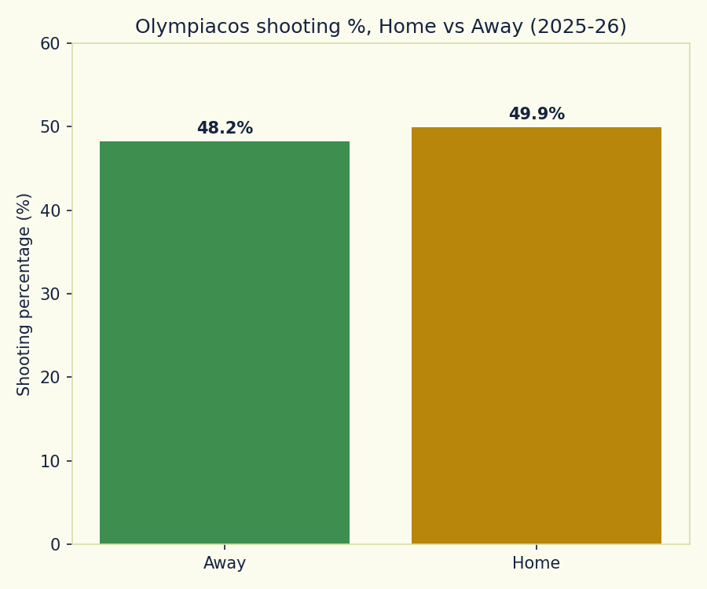
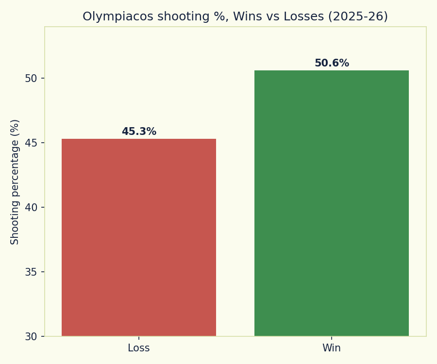
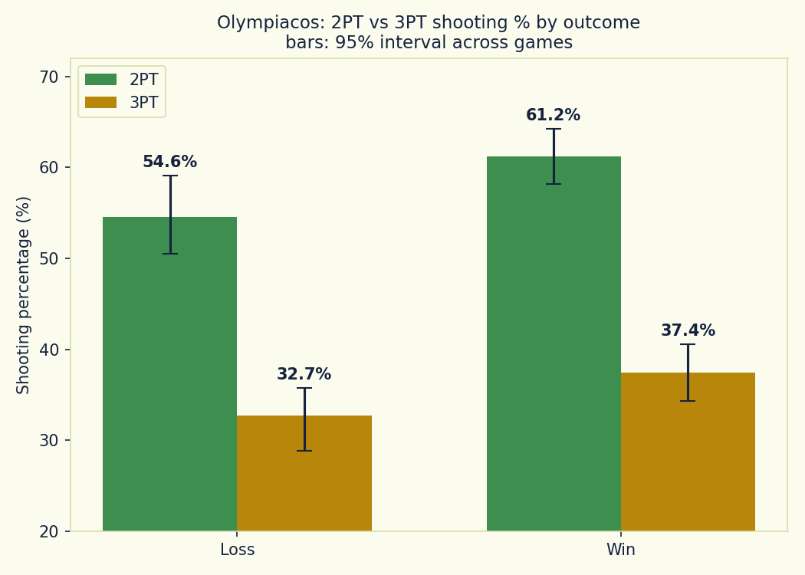
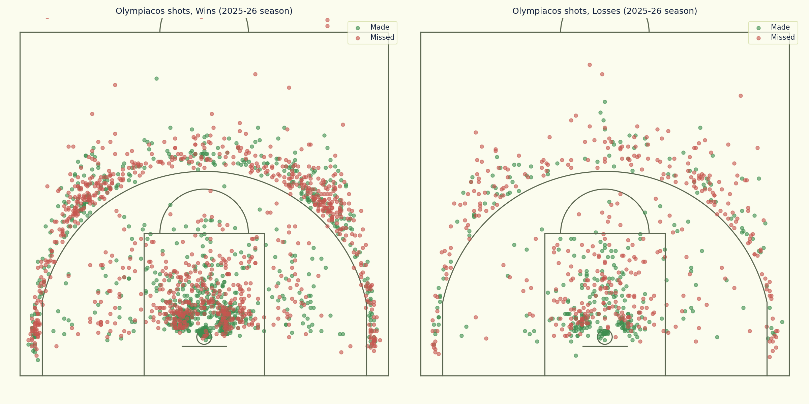

# Olympiacos 2025-26: shot analysis

A shot-level analysis of Olympiacos Piraeus' 2025-26 EuroLeague season (43 games): shot selection by zone, shooting percentage by venue and outcome, and a shot chart of wins and losses. Uncertainty on the win/loss gaps is estimated by bootstrapping over games.

**Brief report:** [open the report](https://htmlpreview.github.io/?https://github.com/viare21/euroleague-shot-analysis/blob/main/olympiacos_report.html)

## Results in brief

1. Olympiacos shoots 50.6% in wins and 45.3% in losses. The 5.3-point gap has a 95% interval of +2.2 to +8.3, so it is positive but imprecise (12 losses).
2. Shot volume is the same in wins and losses (63.3 against 63.1 attempts per game). The gap is about efficiency.
3. The gap is +6.6 on two-pointers and +4.7 on three-pointers, but the difference between the two gaps (+1.9, interval -5.8 to +8.8) is within the noise.

## Data

Source: [Euroleague & Eurocup Datasets](https://www.kaggle.com/datasets/babissamothrakis/euroleague-datasets) (Kaggle).

| File | Columns used |
|---|---|
| `euroleague_points.csv` | `game_id`, `team_id`, `action_id`, `points`, `coord_x`, `coord_y` |
| `euroleague_header.csv` | `game_id`, `season_code`, `team_id_a/b`, `score_a/b`, `phase` |

Scope: season `E2025`, team `OLY`. The 43 games are 38 regular season games, 3 playoff games and 2 Final Four games (31 wins, 12 losses). The shot file holds 3,504 rows for the team, of which 2,721 are field goal attempts and the rest are free throws. 2,718 attempts are used after dropping 3 shots with placeholder coordinates.

## Project structure

| File | Role |
|---|---|
| `olympiacos_shot_analysis.py` | Main script: filters the team, runs the checks, computes the statistics and bootstrap intervals, saves the four charts |
| `court_utils.py` | `draw_half_court`: draws a FIBA half court in meters, basket at the origin |
| `images/` | Output charts (created by the script if missing) |
| `olympiacos_report.html` | Brief report with the narrative and the findings |

The data files are not included in the repository. They are read from a `csv_euroleague` folder placed next to the project folder. The team and season are set by `TEAM_ID` and `SEASON` at the top of the script.

## How it works

The script is organised in numbered sections, run top to bottom.

1. **Paths and load (0, 1).** Paths are relative to the script. Shots and game headers are loaded.
2. **Games (2).** Olympiacos games are the `E2025` games where `team_id_a` or `team_id_b` is `OLY`. Venue is `Home` if Olympiacos is team A, otherwise `Away`. Outcome compares Olympiacos' score with the opponent's.
3. **Shots (3, 4).** Shots by `OLY` in those games are merged with venue and outcome. Free throws (`FTM`) are excluded, because only makes are logged for them. Then:
   - **Made or missed** is `points > 0`.
   - **Shot type** is `2PT` or `3PT` from the first character of `action_id`.
4. **Data quality checks (4.1).** See the next section. Shots with placeholder coordinates are dropped.
5. **Aggregates (5).** Shooting percentage is pooled: total makes divided by total attempts, by venue, by outcome, and by outcome and shot type. Shots per game by outcome is attempts divided by the number of games.
6. **Bootstrap over games (6).** Shots from the same game are not independent, so the game is the unit of resampling. In each of 5,000 draws, wins and losses are resampled separately with replacement, pooled FG% is recomputed and the win minus loss gap is stored. The 95% interval is the 2.5th to 97.5th percentile of the draws. The same is done for two-pointers, three-pointers and the difference between the two gaps. The seed is fixed (42), so results are reproducible.
7. **Zones (7).** A two-pointer inside the FIBA key is `Paint`, otherwise `Mid-range`. Three-pointers are `3PT`. The key is the rectangle `|coord_x| <= 245` and `-157.5 <= coord_y <= 422.5` (cm, basket at the origin). Printed as a table only.
8. **Charts (9 to 12).** Shot chart, and three bar charts.

### Design choices

- Pooled percentages (makes over attempts) are used instead of averages of game percentages, so games with more shots weigh more.
- Free throws are excluded from "shooting percentage". Field goal percentage here does not account for the extra point of a three-pointer, so 3PT and 2PT percentages are not directly comparable as value.
- Wins and losses are resampled separately because the two groups have very different sizes (31 and 12 games).

## Data quality checks

| Check | Result |
|---|---|
| Shots with an unrecognised `action_id` | 0 |
| Missing (NaN) coordinates | 0 |
| Placeholder coordinates (0, 0) | 3 shots, dropped |
| Median distance from the basket | 3PT 732 cm, 2PT 159 cm |
| Three-pointers closer than 600 cm | 1 |
| Two-pointers farther than 700 cm | 1 |
| Games by outcome | 31 wins, 12 losses |

A shot at (0, 0) would sit under the basket, which is where a missing coordinate is stored. The three-point line is 660 cm from the basket in the corners and 675 cm at the top, so a three-pointer closer than 600 cm or a two-pointer farther than 700 cm is most likely a coordinate or coding error. There is one of each kind, and they are left in.

## Outputs

`images/shooting_pct_home_away.png`: field goal percentage at home (49.9%) and away (48.2%). The gap was not tested for uncertainty.

`images/shooting_pct_win_loss.png`: field goal percentage in wins (50.6%) and losses (45.3%).

`images/shooting_pct_2pt_3pt.png`: two-point and three-point percentage by outcome.

| Shot type | Win % | Loss % | Gap | 95% interval |
|---|---|---|---|---|
| All field goals | 50.6 | 45.3 | +5.3 | +2.2 to +8.3 |
| 2PT | 61.2 | 54.6 | +6.6 | +1.2 to +11.8 |
| 3PT | 37.4 | 32.7 | +4.7 | +0.3 to +9.5 |

`images/shot_chart_wins_losses.png`: every field goal attempt, wins and losses. The wins panel has more dots because there are 31 wins and 12 losses, not because of more shots per game.

Shot volume and zone shares:

| | Wins | Losses |
|---|---|---|
| Shots per game | 63.3 | 63.1 |
| Paint | 45.4% | 48.5% |
| Mid-range | 10.0% | 9.1% |
| 3PT | 44.6% | 42.4% |

## How to run

1. Download the dataset from Kaggle and place `euroleague_points.csv` and `euroleague_header.csv` in a folder named `csv_euroleague`, one level above this project's folder.
2. Install the requirements: `pip install pandas numpy matplotlib`
3. Run `olympiacos_shot_analysis.py`. `court_utils.py` must be in the same folder.

In Spyder, press F5 to run the whole file. Running cell by cell (F9) also works: if `__file__` is not defined, the script falls back to the current working directory, so set it to the project folder first.

## Limitations and possible extensions

- The sample is one season of one team, with 12 losses. The intervals are wide, and results for other teams or seasons could differ.
- Shooting well and winning are linked by construction, so the gap between wins and losses describes the two going together, not a cause. Opponent defense, the quality of shots and game situation are not controlled.
- Field goal percentage does not value three-pointers more. The analysis could be extended with eFG% by zone and a comparison with the rest of the league in the same season.
- The home/away gap and the zone shares are not tested for uncertainty. The same bootstrap can be applied.
- The shot chart is descriptive. It could be extended by splitting shots into finer zones, using the coordinates, and comparing their efficiency in wins and losses.
